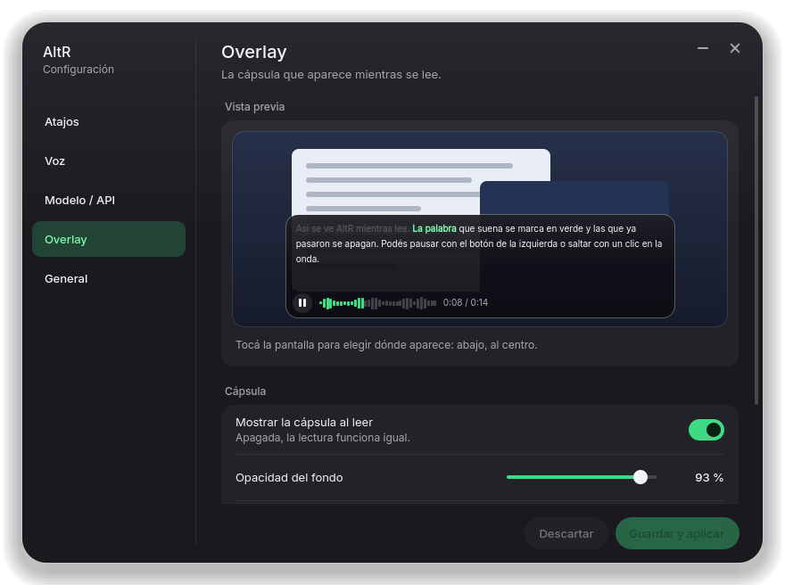
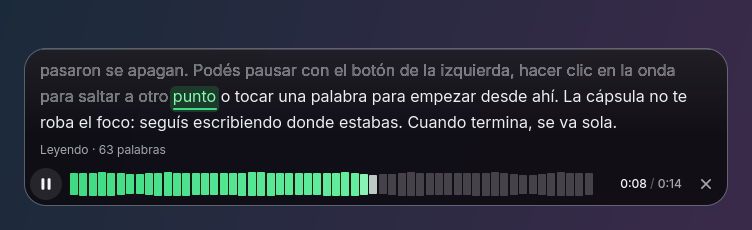

# AltR — leer en voz alta con un atajo (Windows)

Seleccioná texto en **cualquier programa** (navegador, PDF, Word, Discord…), apretá **Ctrl+Alt+R** y una voz
natural te lo lee, con una cápsula flotante que marca la palabra que suena. Apretá **Ctrl+Alt+S** para cortar. Vive como un ícono junto al reloj.

- Gratis y **sin cuenta ni clave**: usa por defecto las voces neuronales de Microsoft Edge (necesita internet).
- Configurable en un solo archivo: voz, velocidad, volumen, atajos.
- Enchufable: también funciona con **OpenAI** (o cualquier API compatible, local o remota) y con motores
  locales por línea de comandos como **Piper**. El modelo lo elegís vos en el config, sin tocar código.
- Nativo de Windows 10/11. No hace falta WSL ni instalar Python (si usás el `.exe`).

Es el port a Windows de la función "Alt+R" de un asistente de voz para Linux.

---

## Instalación (Windows 10/11)

### Opción A — un comando (recomendada)

Abrí **PowerShell** (no hace falta ser administrador) y pegá:

```powershell
[Net.ServicePointManager]::SecurityProtocol = [Net.SecurityProtocolType]::Tls12; irm https://raw.githubusercontent.com/FeroxShark/alt-r-windows/main/install.ps1 | iex
```

(La primera parte fuerza TLS 1.2: Windows PowerShell 5.1 a veces arranca con un TLS viejo que GitHub rechaza.
Sirve en Windows PowerShell 5.1 y en PowerShell 7. Se baja de la rama `main` y no del release porque GitHub
entrega los archivos de un release como binario y `irm` no los lee como texto.) Descarga `AltR.exe`, lo deja en `%LOCALAPPDATA%\AltR`, crea un acceso directo en el menú Inicio y lo arranca.
Para que además **arranque solo con Windows**:

```powershell
[Net.ServicePointManager]::SecurityProtocol = [Net.SecurityProtocolType]::Tls12; & ([scriptblock]::Create((irm https://raw.githubusercontent.com/FeroxShark/alt-r-windows/main/install.ps1))) -Autostart
```

### Opción B — bajar el `.exe` a mano

1. Entrá a la página de [Releases](https://github.com/FeroxShark/alt-r-windows/releases/latest) y bajá `AltR.exe`.
2. Ponelo en una carpeta que no se borre (por ejemplo `C:\Users\vos\AltR`) y hacé doble clic.
3. Para que arranque con Windows: clic derecho en el ícono de la bandeja → **Iniciar con Windows**.

> **Aviso de Windows (SmartScreen):** como el `.exe` no está firmado digitalmente, Windows puede decir
> "Windows protegió su PC". Tocá **Más información → Ejecutar de todas formas**. Algunos antivirus
> desconfían de los `.exe` hechos con PyInstaller; podés revisar el código y compilarlo vos (Opción C).

### Opción C — desde el código fuente

Necesitás Python 3.11 o más nuevo (`winget install Python.Python.3.12`).

```powershell
git clone https://github.com/FeroxShark/alt-r-windows
cd alt-r-windows
.\install.ps1 -Autostart      # crea un entorno propio en %LOCALAPPDATA%\AltR y lo arranca
```

O para probarlo sin instalar nada: `py -3 -m pip install .` y después `py -3 -m altr`.

> Si PowerShell dice que "la ejecución de scripts está deshabilitada", corré una vez
> `Set-ExecutionPolicy -Scope CurrentUser RemoteSigned` o ejecutá con
> `powershell -ExecutionPolicy Bypass -File .\install.ps1`.

### Primer uso

1. Después de instalar aparece un ícono (un parlante) junto al reloj. Si no lo ves, está dentro de la
   flechita **^** de la bandeja; arrastralo afuera para dejarlo fijo.
2. Seleccioná cualquier texto y apretá **Ctrl+Alt+R**. La primera vez tarda un segundo más.
3. **Ctrl+Alt+S** corta la lectura (también la X de la cápsula). Un Ctrl+Alt+R nuevo corta lo que esté sonando y lee lo nuevo.

---

## Atajos y menú de la bandeja

| Atajo (por defecto) | Qué hace |
|---|---|
| **Ctrl+Alt+R** | Lee el texto seleccionado (si no hay nada seleccionado, lee el portapapeles). |
| **Ctrl+Alt+S** | Corta la lectura. |

(El atajo no es `Alt+R` a secas porque la NVIDIA App lo reserva para su overlay; ver *Problemas comunes*.)

Clic derecho en el ícono: **Detener lectura** · **Leer el portapapeles** · **Configuración…** ·
**Abrir config.toml** · **Recargar configuración** · **Abrir registro (log)** · **Iniciar con Windows** · **Salir**.
(Clic izquierdo = detener.) El ícono se pone verde mientras lee.

Cómo funciona: AltR simula un `Ctrl+C` en la ventana activa, lee lo copiado y te **devuelve el portapapeles
como estaba** (sólo texto; si tenías una imagen copiada, se pierde). En terminales (Windows Terminal, cmd,
PowerShell…) **no** manda `Ctrl+C`, porque ahí interrumpiría lo que esté corriendo: copiá vos el texto y
apretá Ctrl+Alt+R para leer el portapapeles.

---

## Actualizar

- **Desde la ventana:** Configuración → *General* → **Buscar actualizaciones**. Si hay una versión nueva aparece
  **Actualizar**: baja `install.ps1` de este repo y lo corre en un PowerShell aparte (cierra AltR, reemplaza el
  `.exe` y lo vuelve a abrir).
- **Aviso automático:** al arrancar, una vez por día, AltR mira si hay una versión nueva y te lo dice con un globo
  de la bandeja. Se apaga con `check_updates = false` en `[general]` o desde *General*.
- **A mano:** volvé a correr el comando de instalación (arriba). **La configuración se conserva.**

---

## Configuración

### La ventana

Clic derecho en el ícono → **Configuración…** (o `AltR.exe --settings`). Tiene cinco secciones:

- **Atajos**: se cambian apretando el atajo nuevo (te avisa si otro programa ya lo usa).
- **Voz**: motor, voz (filtrable por idioma), velocidad, volumen y **Probar voz**.
- **Modelo / API**: dirección, modelo y clave de una API compatible con OpenAI. La clave se guarda en el
  Administrador de credenciales de Windows, nunca en el `config.toml`.
- **Overlay**: activar, posición, opacidad, tamaño de letra y una vista previa en vivo de la cápsula.
- **General**: iniciar con Windows, avisos, versión instalada, **Buscar actualizaciones** y *Abrir config.toml*.



*Guardar y aplicar* escribe el `config.toml` (conserva sus comentarios y todo lo que la ventana no toca) y
recarga AltR al instante.

### El archivo

El archivo está en **`%APPDATA%\AltR\config.toml`** (se crea solo la primera vez, con comentarios).
También podés editarlo a mano: ícono → *Abrir config.toml*, guardalo y elegí *Recargar configuración*.
Lo que borres toma el valor por defecto. Si te equivocás, AltR te avisa y sigue con la configuración anterior.

### `[general]`

| Campo | Por defecto | Qué es |
|---|---|---|
| `hotkey` | `"ctrl+alt+r"` | Atajo para leer. Modificadores `alt`, `ctrl`, `shift`, `win` + una tecla (letra, número, `f1`…`f24`, `space`, `enter`, flechas…). Ej.: `"ctrl+alt+l"`. |
| `stop_hotkey` | `"ctrl+alt+s"` | Atajo para cortar. `""` = ninguno. |
| `clipboard_fallback` | `true` | Sin selección, leer el portapapeles. |
| `restore_clipboard` | `true` | Devolver el portapapeles como estaba tras copiar la selección. |
| `clipboard_only_apps` | terminales | Programas donde no se manda `Ctrl+C` (se lee el portapapeles). |
| `notifications` | `true` | Globos de aviso cuando algo falla. |
| `check_updates` | `true` | Al arrancar, una vez por día, mira si hay una versión nueva en GitHub y avisa con un globo (no instala nada solo). |

### `[overlay]` — la cápsula de lectura

| Campo | Por defecto | Qué es |
|---|---|---|
| `enabled` | `true` | `false` = sin overlay (la lectura funciona igual). |
| `position` | `"bottom-center"` | `"bottom-center"`, `"bottom-left"`, `"bottom-right"`, `"top-center"`, `"top-left"` o `"top-right"`. |
| `monitor` | `"active"` | `"active"` (el que tiene el mouse), `"primary"` o un número: `1`, `2`, `3`… |
| `opacity` | `0.925` | Opacidad del fondo, 0.3–1.0 (más bajo = más transparente). |
| `font_size` | `16` | Tamaño del texto, 12–28. |

### `[text]`

| Campo | Por defecto | Qué es |
|---|---|---|
| `max_chars` | `20000` | Máximo de caracteres por lectura. |
| `strip_markdown` | `true` | Quita `#`, `*`, `` ` ``, `[texto](enlace)` para que no los deletree. |
| `read_urls` | `false` | `false` = las direcciones web se dicen "enlace". |

### `[tts]` — lo común a todos los motores

| Campo | Por defecto | Qué es |
|---|---|---|
| `provider` | `"edge"` | `"edge"`, `"openai"` o `"command"`. |
| `speed` | `1.0` | Velocidad: `1.2` = 20 % más rápido, `0.8` = más lento. (0.25–4.0) |
| `volume` | `100` | Volumen de AltR, 0–100. |

### Motor `edge` (gratis, sin clave)

```toml
[tts]
provider = "edge"
speed = 1.15

[edge]
voice = "es-AR-ElenaNeural"   # argentina, mujer
pitch = "+0Hz"
proxy = ""
```

Voces en español que andan bien: `es-AR-ElenaNeural`, `es-AR-TomasNeural`, `es-ES-ElviraNeural`,
`es-ES-AlvaroNeural`, `es-MX-DaliaNeural`, `es-MX-JorgeNeural`, `es-CO-SalomeNeural`, `es-US-PalomaNeural`.
Las "multilingües" (`en-US-AvaMultilingualNeural`, `en-US-AndrewMultilingualNeural`) leen bien español e inglés mezclados.
Lista completa: `AltR.exe --list-voices es-` (o `--list-voices` solo, para todas; abre un bloc de notas con el resultado).

### Motor `openai` (OpenAI o cualquier API compatible)

```toml
[tts]
provider = "openai"

[openai]
base_url = "https://api.openai.com/v1"
model = "gpt-4o-mini-tts"       # o "tts-1", "tts-1-hd"…
voice = "coral"
api_key_env = "OPENAI_API_KEY"  # NOMBRE de la variable; la clave NO va en este archivo
instructions = "Hablá en español rioplatense, tranquilo y claro."   # sólo gpt-4o-mini-tts
```

La clave se guarda como variable de entorno. En PowerShell:

```powershell
setx OPENAI_API_KEY "sk-..."
```

y **cerrá sesión de Windows y volvé a entrar** (o salí de AltR y volvelo a abrir desde una consola nueva) para que la tome.

Servidores propios o locales que hablan el mismo protocolo (`/v1/audio/speech`), por ejemplo
[Kokoro-FastAPI](https://github.com/remsky/Kokoro-FastAPI), LocalAI u openedai-speech:

```toml
[openai]
base_url = "http://localhost:8880/v1"
model = "kokoro"
voice = "ef_dora"
api_key_env = ""                 # vacío = sin clave
```

Para usar **otro modelo** alcanza con cambiar `model` y `voice` a lo que acepte tu servidor.

### Motor `command` (Piper u otro programa local)

Cada trozo de texto se le pasa a un programa tuyo, que tiene que generar un `.wav` o `.mp3`.
Ejemplo con [Piper](https://github.com/rhasspy/piper) (descargá `piper.exe` y una voz `.onnx`; funciona sin internet):

```toml
[tts]
provider = "command"

[command]
args = ["C:/piper/piper.exe", "--model", "C:/piper/es_AR-daniela-high.onnx",
        "--length_scale", "{length_scale}", "--output_file", "{output}"]
stdin = true          # Piper recibe el texto por stdin
output_ext = "wav"
```

Se reemplazan: `{output}` (archivo a generar), `{text}`, `{text_file}`, `{voice}` (el campo `voice` de la sección),
`{speed}` y `{length_scale}` (= 1 / velocidad, lo que usa Piper). Usá barras normales `/` en las rutas.

### `[lexicon]` — pronunciación

Para palabras que el motor lee mal, escribí cómo suenan:

```toml
[lexicon]
github = "guitjab"
wifi = "uaifai"
```

---

## Línea de comandos

```text
AltR.exe                        arranca la aplicación residente (lo normal)
AltR.exe --check                valida el config
AltR.exe --demo-overlay [--screenshot a.png]   abre el overlay con una lectura de prueba, lo prueba y sale
AltR.exe --say "Hola" [--out a.mp3]   lee un texto (o lo guarda) sin atajos ni bandeja: sirve para probar voces
AltR.exe --list-voices es-AR    voces de Edge
AltR.exe --config-path          dónde está el config
AltR.exe --settings [seccion] [--screenshot a.png]   abre la ventana de Configuración (atajos, voz, api, overlay, general); con --screenshot guarda una captura y sale
AltR.exe --install-autostart / --remove-autostart
AltR.exe --config otro.toml     usa otro archivo de configuración
```

Con la instalación desde código fuente: `py -3 -m altr …`. Sin consola (el `.exe` no tiene), los resultados de
`--check`, `--list-voices` y `--version` se abren en un bloc de notas.

---

## El overlay de lectura



Mientras AltR lee aparece una cápsula de vidrio abajo al centro de la pantalla (es el mismo overlay que la versión
de Linux, con la misma estética): el texto en tres líneas con la **palabra que suena marcada en verde** y lo ya leído
apagado, una **onda** que avanza con el audio, el tiempo (`0:08 / 0:14`), el botón de **pausa / seguir** a la izquierda
y la **X** para cortar a la derecha. Mientras se genera la voz muestra «Preparando»; si algo falla, «No pude leer» con
el motivo.

- **Hacé clic en la onda** (o arrastrala) para saltar a otro punto, o **clic en una palabra** del texto para seguir desde
  ahí. Sólo se puede saltar a lo que ya se generó.
- **No te roba el foco ni los clics:** la ventana no se activa, no sale en Alt+Tab ni en la barra de tareas, y todo lo
  que está fuera de la cápsula deja pasar el mouse. Seguís escribiendo donde estabas.
- Se elige dónde y cómo se ve en la sección `[overlay]` del config (abajo); `enabled = false` lo apaga.
- Para verlo sin hablar con Edge: `AltR.exe --demo-overlay` (lo abre con una lectura de prueba, lo prueba y se cierra).

---

## Problemas comunes

- **`Alt+R` choca con NVIDIA.** El overlay de rendimiento de la NVIDIA App / GeForce Experience usa Alt+R por
  defecto y se queda con ese atajo; por eso AltR viene con `Ctrl+Alt+R`. Si lo cambiaste a `alt+r` y no responde
  (AltR avisa con un globo y en el registro: «No pude registrar el atajo»), dos salidas: (1) volver a un atajo con
  `ctrl`: ícono → *Abrir configuración* → `hotkey = "ctrl+alt+r"` → ícono → *Recargar configuración*; o (2) apagar el
  de NVIDIA: NVIDIA App → *Configuración* → *Funciones* → *Overlay* →
  *Atajos de teclado* (o GeForce Experience → engranaje → *Superposición en el juego* → *Atajos de teclado*) y
  cambiá o quitá «Mostrar/Ocultar el rendimiento».
- **Con `alt+<letra>` en Firefox no lee (o se abre la barra de menús).** Firefox muestra su barra de menús al
  soltar Alt y esa pulsación se come el Ctrl+C. AltR mete una tecla intermedia para evitarlo; si en tu caso igual
  pasa, usá un atajo con `ctrl` (`"ctrl+alt+l"`), que Firefox no interpreta como menú.
- **El atajo no hace nada.** Mirá el aviso del globo o el registro (ícono → *Abrir registro*). Si dice "otro programa ya
  usa ese atajo", cambiá `hotkey` en el config (por ejemplo `"ctrl+alt+l"`) y recargá.
- **Dice "No hay texto seleccionado".** Algunos programas no responden a `Ctrl+C` (juegos, apps con permisos de
  administrador: Windows no deja que un programa normal le mande teclas a uno elevado). Copiá el texto a mano y
  apretá Ctrl+Alt+R: lee el portapapeles.
- **No suena nada / error de conexión.** El motor `edge` necesita internet. Probá `AltR.exe --say "hola"`. Si Microsoft
  responde 403, actualizá AltR (a veces cambian el servicio y `edge-tts` se actualiza).
- **Al soltar Alt se abre un menú del programa.** AltR intenta evitarlo; si te pasa en algún programa, usá un atajo con
  `ctrl` (el de fábrica, `"ctrl+alt+r"`, ya lo es).
- **No veo la cápsula.** Mirá que `[overlay] enabled` sea `true` y el `monitor` exista. Si el registro dice «el overlay no
  cargó», avisá con ese texto. `AltR.exe --demo-overlay` la abre con una lectura de prueba.
- **La cápsula tapa algo.** Cambiá `position` (por ejemplo `"top-right"`) o bajale la `opacity`; los clics fuera de
  la cápsula pasan de largo.
- **No cambia la velocidad desde la cápsula.** A diferencia de Linux, acá la velocidad es la de `[tts] speed`.
- **El portapapeles quedó con otra cosa.** Sólo se restaura texto. Poné `restore_clipboard = false` si preferís que
  quede lo seleccionado.
- **Hay pausas entre frases.** Cada frase se genera por separado; con motores lentos (una API remota lejana) puede
  haber una pausa corta. Probá un motor más rápido o más cercano.
- **Sale "Falta la variable de entorno …".** Creaste la clave con `setx` pero no volviste a iniciar sesión.
- **"Windows protegió su PC".** Ver el aviso de SmartScreen más arriba.
- **Quiero ver qué pasa.** El registro está en `%APPDATA%\AltR\altr.log`.

---

## Desinstalar

Con el instalador:

```powershell
[Net.ServicePointManager]::SecurityProtocol = [Net.SecurityProtocolType]::Tls12; & ([scriptblock]::Create((irm https://raw.githubusercontent.com/FeroxShark/alt-r-windows/main/install.ps1))) -Uninstall
```

(agregá `-Purge` para borrar también tu configuración en `%APPDATA%\AltR`). A mano: ícono → *Iniciar con Windows*
(destildar) → *Salir*, y borrá `%LOCALAPPDATA%\AltR` y `%APPDATA%\AltR`.

---

## Para desarrolladores

```text
altr/
  cli.py        línea de comandos y arranque
  app.py        aplicación residente (atajos + lector + bandeja)
  ui.py         Qt (PySide6): ícono de bandeja y overlay (QQuickView); un solo QApplication
  settings.py   ventana de Configuración: modelo (SettingsController, edita el toml con tomlkit) y vista
  qml/settings/Settings.qml  la vista de la ventana (sólo `import QtQuick`)
  updates.py    actualizaciones: último release de GitHub, chequeo diario, instalador
  secrets.py    clave de la API en el Administrador de credenciales (keyring)
  qml/Overlay.qml  el overlay (port del de Quickshell de Linux) y qml/fonts/ (Inter, OFL)
  demo.py       --demo-overlay: lectura de prueba y comprobaciones del overlay
  audio.py      duración y onda aproximada de cada trozo
  reader.py     trocea, sintetiza por adelantado y reproduce; una lectura nueva corta la anterior
  providers.py  motores: edge, openai (API compatible), command
  config.py     lectura y validación del config (los valores por defecto salen de config.default.toml)
  text.py       limpieza de texto y troceado por frases
  hotkeys.py    parseo de atajos ("ctrl+alt+r")
  win.py        capa de Windows con ctypes: portapapeles, SendInput, RegisterHotKey, reproducción MCI, autoarranque
tests/          unittest; todo menos test_win.py corre en cualquier sistema (test_ui.py necesita PySide6 y usa
                Qt offscreen: `QT_QPA_PLATFORM=offscreen`)
altr.spec       PyInstaller;  install.ps1  instalador;  .github/workflows/build.yml  CI + release
```

```powershell
python -m unittest discover -s tests -t . -v      # tests (los de Windows sólo corren en Windows)
ALTR_TEST_NETWORK=1 python -m unittest tests.test_providers   # incluye una síntesis real con Edge
.\scripts\build-exe.ps1                           # arma dist\AltR.exe
```

**Publicar una versión:** subí el número en `altr/__init__.py`, hacé `git tag v0.1.0 && git push --tags`. El workflow
prueba en Windows, arma `AltR.exe` y crea el release con `AltR.exe`, `install.ps1` y `config.default.toml`.

Agregar un motor: una clase con `synthesize(text, out_dir, name) -> Path` en `providers.py` y una entrada en
`make_provider` y en `PROVIDERS` (`config.py`).

## Licencia

[MIT](LICENSE).
